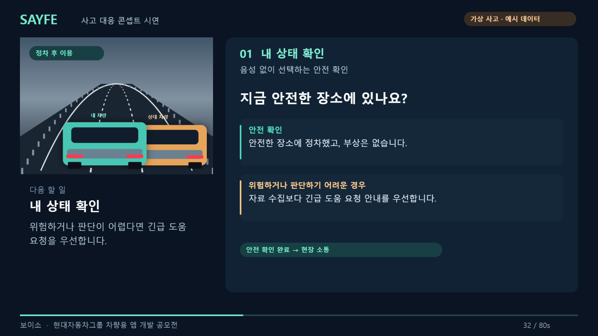
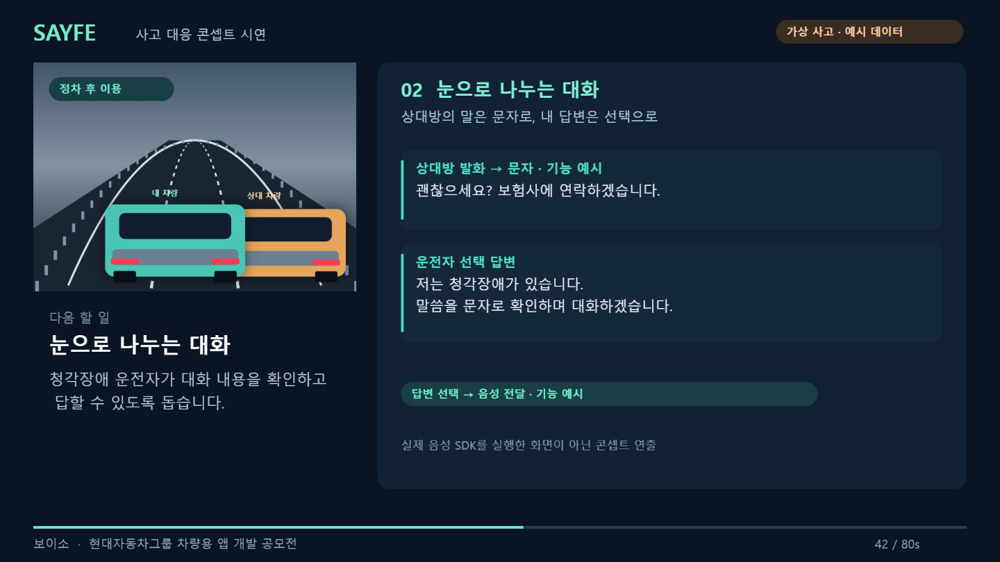
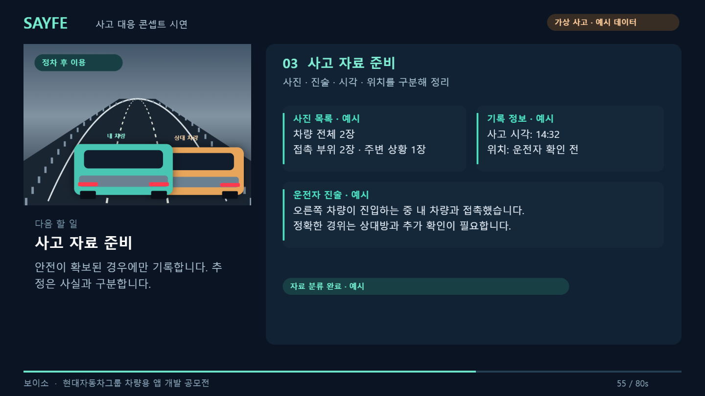
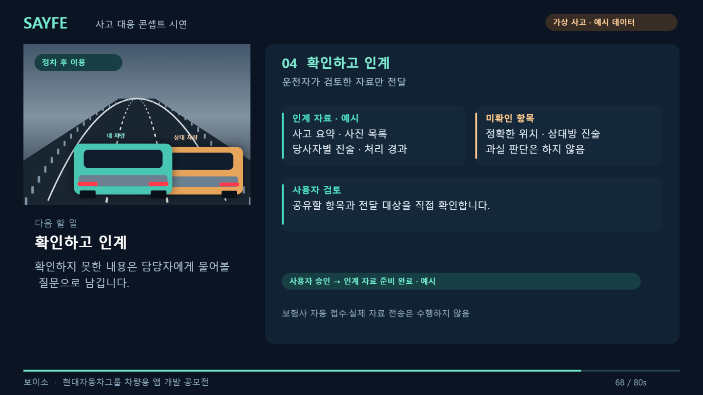
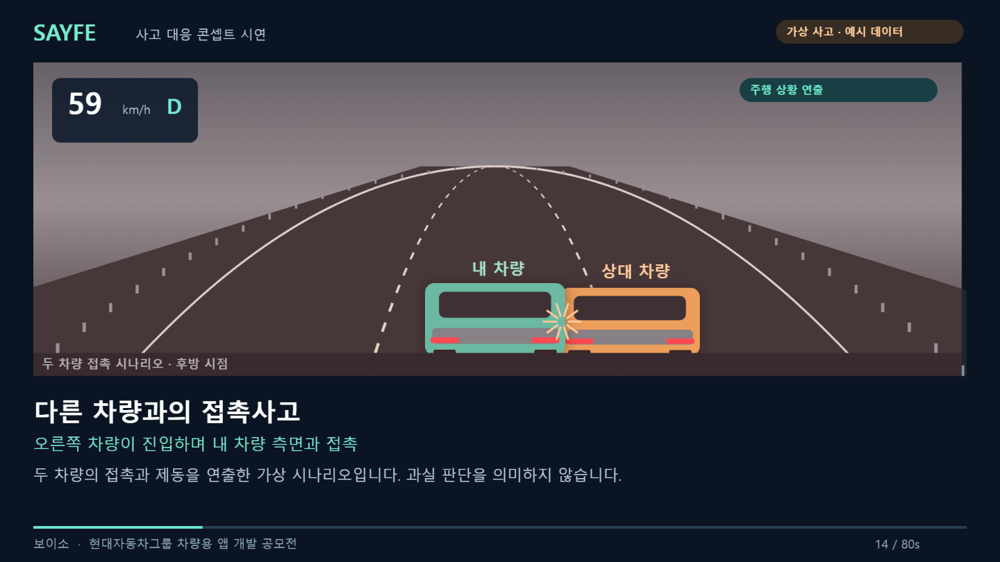

# SAYFE

**청각장애 운전자가 사고 이후의 다음 행동을 눈으로 확인하고, 현장에서 소통하며, 인계할 자료를 준비하도록 돕는 차량용 앱 아이디어입니다.**

현대자동차그룹 차량용 앱 개발 공모전 제출용 아이디어·화면 시안·시연 및 Pleos SDK 기술 검증 자료입니다.

> 개발 상태: **사고 대응 콘셉트 시연 + SDK 연동 검증** 단계입니다. Android APK는 Vehicle·NaviHelper 테스트 앱이며, 영상의 사고 대응 기능을 구현한 완성 앱은 아닙니다.

## 먼저 보기

| 자료 | 내용 |
|---|---|
| [시연 홈페이지](https://leekybin.github.io/SAYFE-contest-submission/) | 영상 2종, 화면 시안, 구현 범위를 한 페이지로 제공 |


GitHub의 HTML 파일 화면은 웹사이트 실행 화면이 아닙니다. 저장소의 **About / Website에 등록한 GitHub Pages 주소**로 접속하거나 아래 로컬 실행 방법을 사용하세요. MP4 미리보기가 지원되지 않으면 파일의 **Download raw file**로 내려받아 Chrome·Edge 또는 동영상 플레이어로 재생할 수 있습니다.

## 해결하려는 문제

사고 이후에는 긴급 연락뿐 아니라 상대방과 대화하기, 사진 준비하기, 사고 경위 설명하기, 보험 담당자의 추가 요청 확인하기가 필요합니다. 음성 중심 안내를 이용하기 어려운 청각장애 운전자에게 이 과정은 큰 부담이 될 수 있습니다.

SAYFE는 **시각적 단계 안내**, **문자 중심 소통**, **사실과 미확인 내용을 구분한 기록**, **사용자 검토 후 인계**를 하나의 흐름으로 제안합니다.

## 대표 시나리오

오른쪽 차선의 차량이 진입하며 내 차량 측면과 접촉하는 가상의 상황입니다. 민트색은 내 차량, 주황색은 상대 차량입니다. 이 연출은 과실 판단을 의미하지 않습니다.

1. 안전한 정차 상황으로 전환하고 부상·위험 여부를 확인합니다.
2. 위험하거나 판단하기 어려우면 자료 수집보다 긴급 도움 요청을 우선합니다.
3. 상대방 발화를 문자로 확인하고, 운전자는 답변을 입력하거나 선택합니다.
4. 안전이 확보된 경우 사진·시각·확인한 위치·당사자별 진술을 정리합니다.
5. 미확인 항목을 질문으로 남기고, 운전자가 공유 내용을 검토합니다.
6. 승인한 자료를 담당자에게 인계하는 경험으로 연결합니다.

## 화면 시안

다음 화면은 **콘셉트 애니메이션의 UI 시안**입니다. 실제 Android 사고 대응 화면은 아닙니다.

| 안전 확인 | 현장 소통 |
|---|---|
|  |  |

| 사고 자료 정리 | 검토 및 인계 |
|---|---|
|  |  |



## 실제 구현과 콘셉트 구분

| 항목 | 현재 상태 |
|---|---|
| Vehicle SDK 2.3.2 | 도어 capability 조회 및 네 도어 현재값 조회 코드 구현·에뮬레이터 수신 확인 |
| NaviHelper 3.0.5 | 초기화·연결/실패 콜백·해제 코드 구현. 이번 제출에서 실제 연결 성공을 별도 보증하지 않음 |
| Android 앱 | 기존 SDK 테스트 앱 유지. 디버그 빌드 및 설치 성공 |
| Pleos 주행 장면 | 에뮬레이터 0→45km/h→0, D→P를 실제 촬영 |
| 두 차량 접촉·충돌 효과 | 별도 애니메이션 연출. 실제 충돌 물리 및 사고 자동 감지 아님 |
| 안전 확인·문자 소통·자료 정리·인계 화면 | 콘셉트 UI 및 시연 |
| STT/TTS·AI 사진 분석·요약·번역·Gleo·자동 위치 | 미연결 / 후속 개발 범위 |
| PDF·보험사 접수·외부 전송 | 현 Android 앱에서 제공하지 않음 |

## 실행 방법

### 시연 자료만 보기

저장소를 다운로드한 후 **demo/index.html을 Chrome 또는 Edge로 열면** 됩니다. Node.js나 Android SDK 없이도 화면 시안과 MP4를 볼 수 있습니다.

로컬 HTTP 재생이 필요한 경우 Node.js 설치 후 프로젝트 루트에서 실행합니다.

```text
node demo/serve-demo.cjs
```

브라우저 접속 주소는 터미널에 표시됩니다. 이 주소는 **해당 PC 전용이며 공모전 제출 링크가 아닙니다.**

### Android SDK 테스트 앱 실행

- Android Studio 및 프로젝트의 Gradle Wrapper 사용
- compileSdk / targetSdk 37, minSdk 34
- Gradle Daemon JVM 조건: 25
- Pleos Connect v2.1.0 전용 AVD (Android API 34)
- Vehicle 2.3.2 / NaviHelper 3.0.5를 Gradle에서 내려받을 수 있어야 함

```text
# Windows
.\gradlew.bat :app:assembleDebug

# macOS / Linux
./gradlew :app:assembleDebug
```

APK 출력: app/build/outputs/apk/debug/app-debug.apk

SDK와 서비스 지원 범위·권한은 실행 환경에 따라 다릅니다. 일반 휴대폰 에뮬레이터에서 차량 서비스 연결이 보장되지 않습니다.

## 구조

```text
app/                       Vehicle·NaviHelper 기술 검증 Android 앱
demo/index.html            심사용 자료 모음 홈페이지
demo/sayfe-demo.html        직접 조작하는 콘셉트 애니메이션
demo/SAYFE_pleos_demo.mp4   실제 Pleos 촬영 + 접촉 재현
demo/SAYFE_concept_demo.mp4 콘셉트 영상
demo/preview-*.png          화면 시안 및 영상 미리보기
demo/*.cjs                 촬영·렌더링·변환·재생 검증 도구
docs/                      구현 범위·공개 및 제출 안내
index.html + .nojekyll      GitHub Pages 진입점
```
