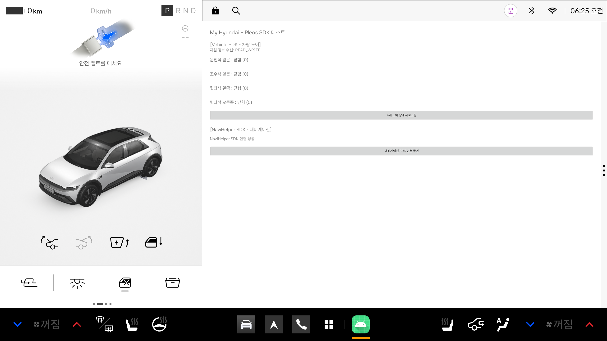

# 제출 release APK

[보이소_SAYFE_release.apk 다운로드](https://raw.githubusercontent.com/leekybin/SAYFE-contest-submission/main/apk/%EB%B3%B4%EC%9D%B4%EC%86%8C_SAYFE_release.apk)

| 항목 | 값 |
|---|---|
| 팀명 / 앱명 | 보이소 / SAYFE |
| 저장소 내 경로 | apk/보이소_SAYFE_release.apk |
| 변형 | release, debuggable=false |
| 패키지 | com.example.myhyundai |
| 앱 목록 이름 | My Hyundai (기존 SDK 테스트 앱) |
| 버전 | 1.0 / versionCode 1 |
| 최소 / 타깃 API | 34 / 37 |
| 크기 | 13,712,409 bytes |
| 서명 | 전용 RSA 3072비트 키, APK Signature Scheme v3 |
| SHA-256 | b1fb38d2caa22b4e990f276909584571f27b5df43382ff3903976435e83dca94 |

## 실제 release 실행 화면

## 확인 결과

- :app:assembleRelease 빌드 성공
- apksigner verify 및 zipalign 검증 통과
- debuggable 플래그 없음 확인
- Pleos Connect v2.1.0 / API 34 / 2560×1440 / 160dpi에 설치·실행
- NaviHelper 연결 성공 화면 확인
- 도어 capability READ_WRITE 및 네 도어 닫힘(0) 수신 확인

초기 release에서 Kotlin·AndroidX 최적화 관련 IllegalAccessError가 발생하여 release 최적화를 비활성화했습니다.
현재 APK는 해당 수정 후 다시 빌드·서명·설치·실행한 파일입니다.

현재 APK의 기능은 SDK 연동 테스트입니다. 영상의 사고 대응 UI·AI 분석·자동 신고·보험사 전송 기능은 포함하지 않습니다.
서명 키와 비밀번호는 이 저장소에 업로드하지 않습니다.
